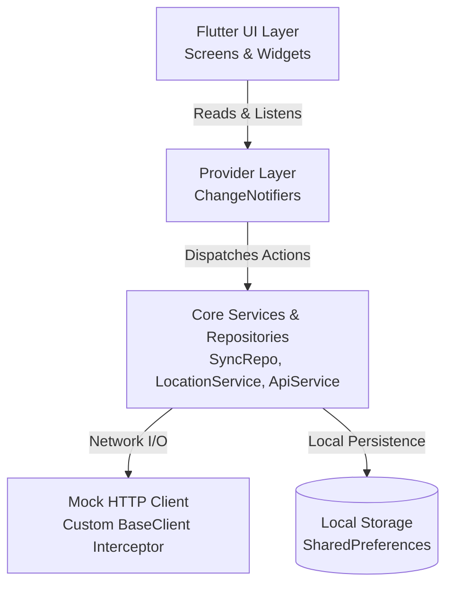
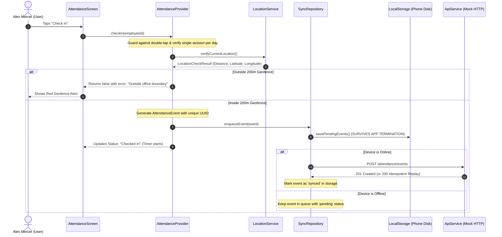

# REBS HRMS: Complete System Architecture & Operational Guide

This document explains every subsystem, data lifecycle, business logic decision, and the exact sequence of events happening inside your Flutter application.

---

## 1. High-Level Architecture Overview

The app follows a **Clean Feature-First Architecture** powered by **Provider** (`ChangeNotifier`):



### Layer Responsibilities
1. **Presentation (`lib/features/*/presentation/`)**:
   - Pure UI widgets strictly below 200 lines each.
   - They contain **no raw business calculations**. Instead, they read state using `context.watch<T>()` and trigger actions via `context.read<T>()`.
2. **State Management (`lib/features/*/presentation/providers/`)**:
   - `DashboardProvider`, `AttendanceProvider`, `LeaveProvider`.
   - Extends `ChangeNotifier` to hold view state and call `notifyListeners()` when data changes.
3. **Core Repositories & Utilities (`lib/core/`)**:
   - `SyncRepository`: The offline queue engine.
   - `LocalStorageService`: Reads/writes JSON strings to disk via `SharedPreferences`.
   - `LocationService`: Calculates distances using the Haversine formula and handles GPS permissions/mocking.
   - `ApiService`: Typed Dart client interacting with the REBS API.
   - `MockHttpClient`: Intercepts HTTP calls at the client level.

---

## 2. Deep Dive: What Happens During Attendance Check-In / Check-Out?



### Key Highlights:
1. **Double-Tap Protection**: `_isActionInProgress` is set to `true` immediately on button tap, disabling the buttons and preventing duplicate calls.
2. **GPS / Geofencing**:
   - In `location_service.dart`, the distance between employee and office is calculated using the **Haversine formula**.
   - If distance $> 200$m, the operation is blocked device-side.
   - Reviewers can change the simulation mode (`At Office`, `Outside ~350m`, `Real GPS`) via the settings modal.
3. **Persistence First**:
   - The event is **written to disk (`SharedPreferences`) before network transmission is even attempted**.
   - Even if the phone battery dies or the OS kills the process right after tapping Check In, the event is safe in local storage.

---

## 3. Deep Dive: The Offline Synchronization & Idempotency Engine

This is the central engineering challenge of the assignment.

### A. How Idempotency Works
- If a mobile user is in a low-signal area, a network request can succeed on the server, but the server's HTTP response may get lost before reaching the phone (**Timeout / Connection Dropped**).
- Without idempotency, when the client retries, the server would insert a second check-in, creating a duplicate or throwing an invalid error.
- **Our Solution**:
  - Each event generated on the device gets a unique **UUID**:
    ```dart
    final event = AttendanceEvent(id: _uuid.v4(), ...);
    ```
  - The server stores processed event IDs in `processed_event_ids`.
  - When the client retries the same event, the server detects the ID and returns an **Idempotent 200 OK**:
    ```json
    {
      "message": "Event already processed (Idempotent replay)",
      "status": "synced"
    }
    ```

### B. Chronological Sequence Guarantee
- If an employee checks in while offline at 9:00 AM, and checks out while offline at 5:00 PM, both events sit in the local queue.
- When connection returns, `sync_repository.dart` sorts the queue:
  ```dart
  _pendingQueue.sort((a, b) => a.timestamp.compareTo(b.timestamp));
  ```
- Check-in is always processed and confirmed before check-out is dispatched.
- If an event fails due to a network glitch, sequential processing stops immediately so subsequent dependent actions are not sent out of order.

### C. Automatic vs Manual Sync
- **Automatic**: `NetworkInfo` listens to `Connectivity().onConnectivityChanged`. When switching from `none` to `wifi`/`mobile`, `syncPendingEvents()` triggers automatically.
- **Manual**: Tapping the **Sync Now** icon on the Dashboard app bar initiates sync on demand.

---

## 4. Deep Dive: Leave Application & Validation Rules

When an employee applies for leave, 5 distinct business rules are validated client-side:

| Rule | What It Checks | Code Implementation |
| :--- | :--- | :--- |
| **1. Non-Past Date** | Start date cannot be before today's company date | `startDate.isBefore(today)` |
| **2. Date Ordering** | End date cannot be before start date | `endDate.isBefore(startDate)` |
| **3. Reason Length** | Reason must contain at least 10 non-whitespace characters | `reason.replaceAll(RegExp(r'\s+'), '').length >= 10` |
| **4. Balance Limit** | Calendar days requested $\le$ available balance | `(endDate - startDate).inDays + 1 <= balance` |
| **5. Non-Overlapping** | Dates cannot overlap with existing Pending or Approved leaves | `!start.isAfter(existingEnd) && !end.isBefore(existingStart)` |

### Online Requirement for Leave:
- Attendance check-in/out is allowed offline (queued for later).
- **Leave application strictly requires connectivity** (`_networkInfo.isConnected`).
- If offline, the user is notified with an error message, but **previously fetched leave requests remain cached and readable offline**.

---

## 5. Deep Dive: The Mock HTTP API & Reviewer Controls

The assignment requires:
> *"The Flutter app must use an HTTP client rather than returning hardcoded data directly from widgets... Provide repeatable mock scenarios."*

### How It Works:
Instead of running a separate Node.js server, we implemented `MockHttpClient` extending Dart's official `http.BaseClient`.

Whenever `ApiService` makes a network call:
```dart
client.get(Uri.parse('https://api.rebs-hrms.local/v1/employee/me'));
```
The call passes through `MockHttpClient.send()`, which:
1. Adds simulated network latency (`simulatedDelayMs`).
2. Checks the current `MockApiConfig.scenario`:
   - `normal`: Returns real 200/201 JSON responses.
   - `slowNetwork`: Delays for 3.5s and throws a `TimeoutException`.
   - `serverError`: Returns an **HTTP 500 Internal Server Error** crash response.
   - `duplicateAttendanceConflict`: Returns an **HTTP 409 Conflict** response.
   - `leaveValidationFailure`: Returns an **HTTP 422 Unprocessable Entity** response.

Reviewers can change this scenario at any time by tapping the **Tune icon (⚙️)** in the top bar.
